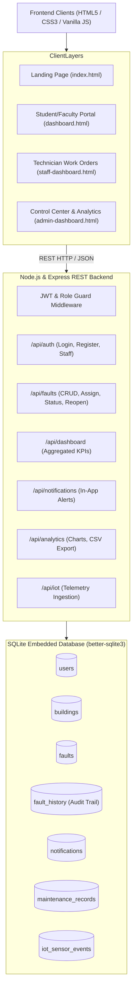
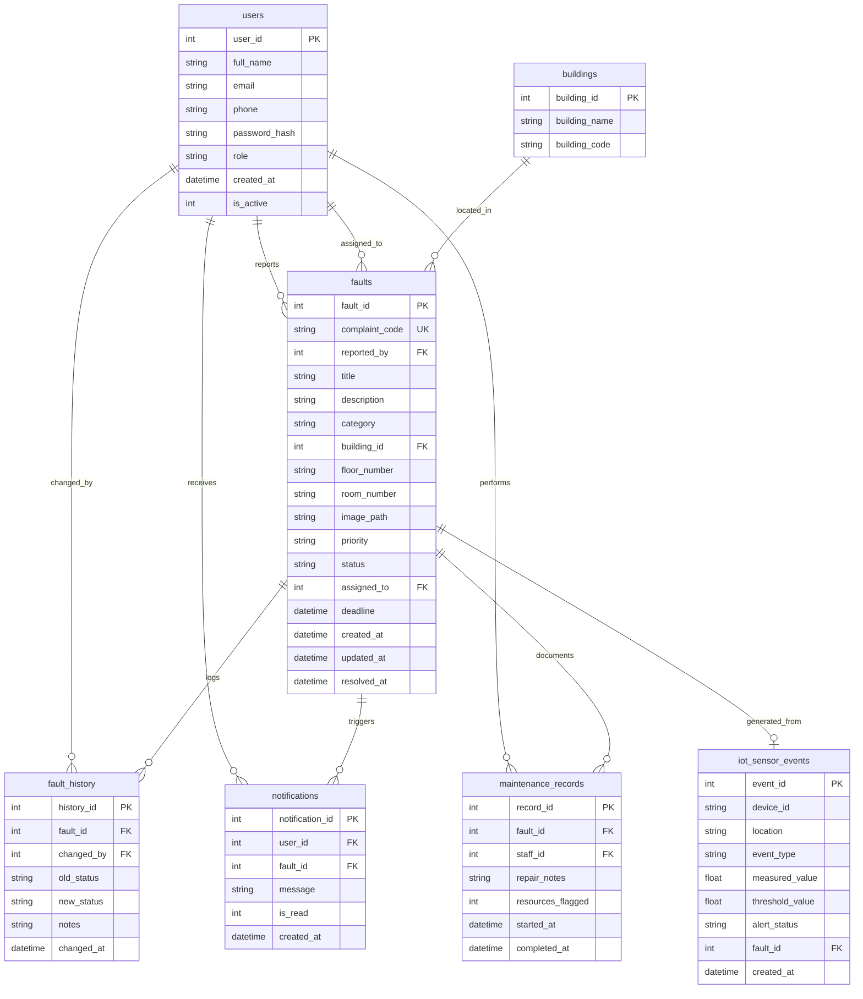
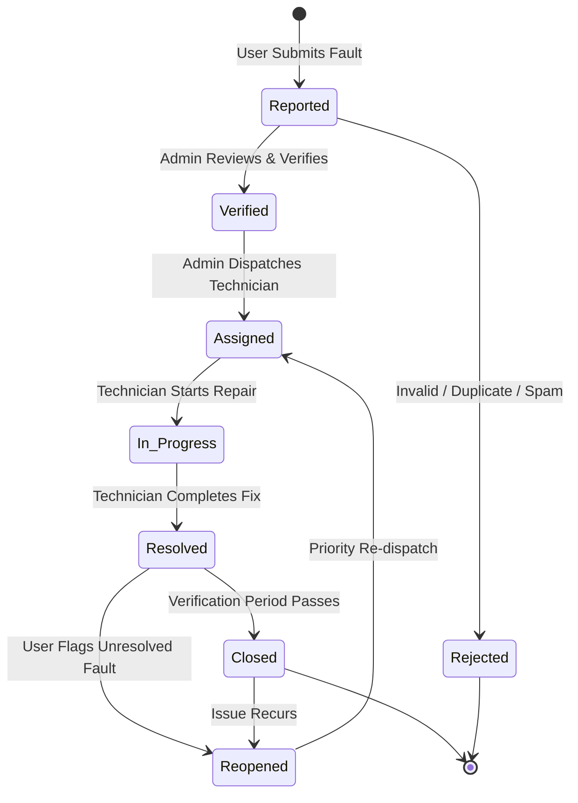

# Campus Fix – Comprehensive Project Documentation & Viva Guide

## 1. Executive Summary & Abstract
**Campus Fix** is an automated, responsive web application engineered to replace inefficient paper registers, verbal complaints, and delayed email reports across university campuses. It establishes a centralized maintenance pipeline linking students, faculty, technician staff, and campus administrators.

The system features real-time fault reporting with geo-spatial room tagging, image attachment support, intelligent duplicate complaint detection, automated deadline tracking, role-based technician dispatch, and dynamic Chart.js analytics for administrative oversight.

---

## 2. System Architecture

---

## 3. Entity Relationship (ER) Diagram

---

## 4. Lifecycle & Workflow Progression

---

## 5. Intelligent Maintenance Features

1. **Real-Time Duplicate Warning Engine:**
   - Evaluates active complaints across matching `(building_id, room_number, category)`.
   - Prevents duplicate work tickets and redundant technician visits.
2. **Automated Urgency Deadlines:**
   - **Critical:** 24-hour turnaround target.
   - **High:** 48-hour turnaround target.
   - **Medium:** 72-hour turnaround target.
   - **Low:** 120-hour turnaround target.
   - Dynamic query calculates `deadline < datetime('now')` and tags tickets as **Overdue** with pulsing red indicators.
3. **Recurring Failure Hotspot Detection:**
   - Aggregates rooms experiencing $\ge 2$ historical complaints in the same facility category.
   - Alerts facilities directors to inspect systemic infrastructure problems.
4. **Future IoT Event Telemetry Interface:**
   - Dedicated REST endpoint `POST /api/iot/events`.
   - Supports automated device logging for power fluctuations, water leaks, and overheating.
   - Automatically generates a critical priority work order if measured values exceed safe thresholds.

---

## 6. Viva Defense & Examination Q&A Guide

### Q1: Why use SQLite instead of MySQL or MongoDB for this system?
> **Answer:** SQLite is an embedded, zero-configuration relational database engine operating in WAL (Write-Ahead Logging) mode. It provides high performance, ACID compliance, and easy portability for demonstration without requiring complex database server daemon setups. It uses native SQL foreign keys and indexes.

### Q2: How does the system handle security and role separation?
> **Answer:** 
> - **Authentication:** Passwords are never stored in plaintext; they are hashed using `bcrypt` with cryptographic salt.
> - **JWT Tokens:** Authenticated requests carry signed JSON Web Tokens containing user ID and role claims.
> - **Authorization Middleware:** `requireRole(['admin'])` and `requireRole(['staff', 'admin'])` protect sensitive endpoints on the server.
> - **SQL Injection Prevention:** 100% of queries use parameterized prepared statements.

### Q3: What is the status workflow for a complaint?
> **Answer:** 
> $$\text{Reported} \to \text{Verified} \to \text{Assigned} \to \text{In Progress} \to \text{Resolved} \to \text{Closed}$$
> Handled with immutable audit entries in `fault_history` whenever state transitions occur.

### Q4: How does the CSV report generation work?
> **Answer:** The `/api/analytics/export` endpoint dynamically constructs a database query based on administrative filters (date range, category, status, priority) and streams an RFC-4180-compliant CSV spreadsheet with headers directly to the browser.
